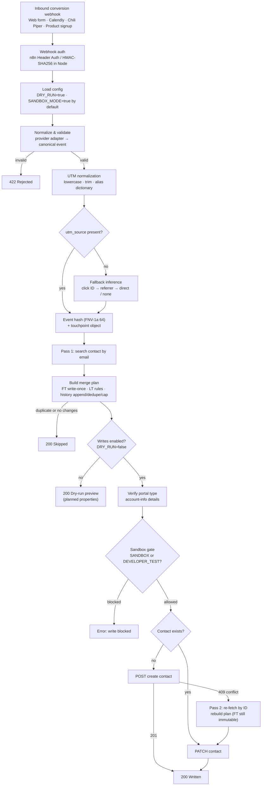

# n8n-hubspot-multi-touch-utm-session-stitcher

A first-party, multi-touch marketing attribution engine for **n8n** and **Node.js**. It takes inbound conversion webhooks (web forms, Calendly and Chili Piper bookings, product signups), normalizes their UTM and click-ID data into one canonical schema, and stitches each session onto the matching **HubSpot Contact**:

- **First Touch** is written once and never overwritten.
- **Last Touch** and the **latest converting asset** update on every qualifying conversion.
- A structured, deduplicated, size-capped **touchpoint history** is kept on the contact as JSON.

I built it fail-safe. On import, **`DRY_RUN=true` and `SANDBOX_MODE=true`**, so nothing is written to a CRM until I deliberately turn those gates off and point the engine at a verified sandbox portal.

---

## Contents

- [Why I built it](#why-i-built-it)
- [Architecture](#architecture)
- [Repository layout](#repository-layout)
- [Canonical event schema](#canonical-event-schema)
- [UTM normalization and aliasing](#utm-normalization-and-aliasing)
- [Attribution rules](#attribution-rules)
- [HubSpot custom property schema](#hubspot-custom-property-schema)
- [Setup guide](#setup-guide)
- [Write modes and safety gates](#write-modes-and-safety-gates)
- [Edge-case handling](#edge-case-handling)
- [Testing and the security scan](#testing-and-the-security-scan)
- [Disclaimer & Limitation of Liability](#️-disclaimer--limitation-of-liability)
- [License](#license)
- [Author](#author)

---

## Why I built it

Native CRM attribution tends to record one "original source" and stop there. Booking tools, product signups, and custom forms each pass UTMs in their own shape (or not at all), casing drifts (`FB`, `facebook.com`, `Facebook`), and click IDs that survive a redirect get ignored when the UTMs don't. The result is first-touch data that gets silently overwritten, last-touch data that "direct" traffic keeps clobbering, and no record of the path in between.

This engine fixes that with three rules I can explain to anyone in one sentence each: First Touch is written once, Last Touch follows the latest real session, and every session is logged once.

---

## Architecture



The same logic runs in two places:

| Runtime | Entry point | Use it for |
| --- | --- | --- |
| n8n | `workflow.json` | Production webhook ingestion inside n8n |
| Node.js | `src/index.js` | Local testing, batch replays, CI, or a small standalone webhook service |

I keep one source of truth. The normalizer, mapper, and config gates live in `src/` inside `// <n8n-core:…>` markers, and `scripts/build-workflow.js` embeds those exact regions into the n8n Code nodes. The test suite fails if `workflow.json` drifts from `src/`, and it executes the n8n Code nodes in a sandbox to prove they produce identical output to the Node modules.

---

## Repository layout

```text
n8n-hubspot-multi-touch-utm-session-stitcher/
├── README.md                      This file
├── DISCLAIMER.md                  Full disclaimer and limitation of liability
├── LICENSE                        MIT
├── workflow.json                  Importable n8n workflow (generated from src/)
├── package.json                   Zero dependencies; node --test
├── .env.example                   Sanitized environment template
├── .gitignore
├── scripts/
│   └── build-workflow.js          Regenerates / checks workflow.json from src/
├── src/
│   ├── index.js                   Engine, HubSpot client, two-pass upsert, CLI, webhook server
│   ├── normalizer.js              Adapters, validation, aliasing, inference, hashing, history
│   ├── hubspot-mapper.js          First-Touch vs Last-Touch payload builder
│   └── config.js                  Fail-safe environment loader and write-target gate
└── test/
    ├── workflow.test.js           60 tests incl. n8n parity and repository security scan
    └── fixtures/
        └── conversion-events-batch.json
```

---

## Canonical event schema

Every provider payload is mapped to this shape before any attribution logic runs.

| Field | Type | Notes |
| --- | --- | --- |
| `event_id` | string | 16-hex FNV-1a 64 hash. Uses the provider's unique ID when one exists (Calendly invitee URI, submission ID, signup event ID), otherwise email + type + asset + timestamp + source + medium + campaign. |
| `ingestion_source` | string | `web_form`, `calendly`, `chili_piper`, `product_signup`, or `canonical` |
| `email` | string | Lowercased and trimmed; validated |
| `event_type` | enum | `form_submission`, `meeting_booked`, `product_signup` (aliases such as `invitee.created`, `user.signup`, `Form Submit` are accepted) |
| `converting_asset` | string | Form name, meeting type, or signup plan; max 200 characters |
| `timestamp` | ISO 8601 | Accepts ISO strings, epoch seconds, or epoch milliseconds |
| `utm_source`, `utm_medium`, `utm_campaign`, `utm_term`, `utm_content` | string | Normalized and aliased (below) |
| `gclid`, `gbraid`, `wbraid`, `msclkid`, `li_fat_id`, `fbclid` | string | Raw click IDs, preserved as received |
| `click_id_type` | string | Which click ID drove inference, if any |
| `landing_page_url`, `referrer_url` | string | As received (max 2,048 characters) |
| `attribution_method` | enum | `utm`, `click_id`, `referrer`, `utm_partial`, or `direct` |

**Provider adapters.** The Calendly adapter reads the `invitee.created` webhook shape (`payload.email`, `payload.tracking.utm_*`, `payload.scheduled_event.name`). The Chili Piper, product-signup, and web-form adapters use the field names in `test/fixtures/conversion-events-batch.json`. Those three are illustrative, because each of those systems lets me shape the payload. I map my real payloads onto them, or send the canonical shape directly. Tracking keys are matched case-insensitively, and any UTM or click ID missing from the payload is recovered from the landing page's query string.

---

## UTM normalization and aliasing

1. **Casing.** Every UTM value is trimmed, inner whitespace is collapsed, and the result is lowercased.
2. **Aliasing.** Lookups use prototype-free dictionaries, so a value like `constructor` can never resolve to a JavaScript built-in.

| Input examples | Normalized |
| --- | --- |
| `fb`, `FB`, `facebook.com`, `m.facebook.com`, `meta` | `facebook` |
| `ig`, `insta`, `instagram.com` | `instagram` |
| `li`, `lnkd.in`, `linkedin.com`, `LinkedIn.com` | `linkedin` |
| `adwords`, `google-ads`, `google.com`, Google country domains | `google` |
| `twitter`, `t.co`, `x.com` | `x` |
| `cpc`, `ppc`, `paidsearch`, `Paid Search`, `sem` | medium `paid_search` |
| `paidsocial`, `Paid-Social`, `social-paid` | medium `paid_social` |
| `email-newsletter`, `e-mail`, `newsletter`, `mail` | medium `email` |
| `social`, `social-media` | medium `organic_social` |
| `organic`, `seo` | medium `organic_search` |
| `banner`, `cpm`, `programmatic` | medium `display` |

Unknown values pass through normalized but unchanged, so I never lose data I haven't mapped yet.

3. **Fallback inference** (only when `utm_source` is missing):

| Priority | Signal | Result |
| --- | --- | --- |
| 1 | `gclid` / `gbraid` / `wbraid` | `google` / `paid_search` |
| 2 | `msclkid` | `bing` / `paid_search` |
| 3 | `li_fat_id` | `linkedin` / `paid_social` |
| 4 | `fbclid` | `facebook` / `paid_social` |
| 5 | Search-engine referrer | engine / `organic_search` |
| 6 | Social referrer | network / `organic_social` |
| 7 | Any other external referrer | referrer host / `referral` |
| 8 | Nothing, or an internal referrer | `direct` / `none` |

A referrer on the same site as the landing page, or on any host in `INTERNAL_HOSTS`, counts as internal navigation, not as a source. When `utm_source` is present but `utm_medium` is missing, the medium comes from the click ID if there is one, and is otherwise set to `unknown`.

---

## Attribution rules

| Rule | Behaviour |
| --- | --- |
| **First Touch is immutable** | `ft_*` fields are written only when `ft_timestamp` is empty or null. Once set, they are never overwritten, not even by an older event that arrives late. That case is flagged with a warning instead. |
| **Last Touch follows the latest session** | `lt_*` fields and `latest_converting_asset` update on every qualifying event. |
| **Out-of-order protection** | An event older than the stored `lt_timestamp` does not touch Last Touch. It is still recorded in the history, in its correct chronological position. |
| **Direct-traffic protection** | With `PROTECT_LAST_TOUCH_FROM_DIRECT=true` (the default), a `direct` / `none` session does not replace a known Last-Touch source stored less than `ATTRIBUTION_WINDOW_DAYS` (default 30) ago. `latest_converting_asset` still updates, because the conversion itself is real, and `lt_timestamp` keeps pointing at the session that holds the Last-Touch credit. |
| **Coherent Last Touch** | If the new session has no campaign, `lt_utm_campaign` is cleared, so a stale campaign never sits next to a new source. |
| **Idempotent retries** | If the event's ID is already in `utm_touchpoint_history`, the whole write is skipped. Webhook retries cost nothing and never double-count. |
| **No-op suppression** | Properties whose value would not change are dropped from the PATCH. If nothing changes, nothing is sent. |

---

## HubSpot custom property schema

I create these on the **Contact** object, in a property group such as `utm_attribution`. The internal names must match exactly.

| Internal name | Label | Type / field type | Write rule |
| --- | --- | --- | --- |
| `ft_utm_source` | First Touch UTM Source | `string` / `text` | Write-once (gated by `ft_timestamp`) |
| `ft_utm_medium` | First Touch UTM Medium | `string` / `text` | Write-once |
| `ft_utm_campaign` | First Touch UTM Campaign | `string` / `text` | Write-once |
| `ft_converting_asset` | First Touch Converting Asset | `string` / `text` | Write-once |
| `ft_timestamp` | First Touch Timestamp | `datetime` / `date` | Write-once gate field |
| `lt_utm_source` | Last Touch UTM Source | `string` / `text` | Overwrite on qualifying events |
| `lt_utm_medium` | Last Touch UTM Medium | `string` / `text` | Overwrite on qualifying events |
| `lt_utm_campaign` | Last Touch UTM Campaign | `string` / `text` | Overwrite (cleared when the new session has none) |
| `lt_timestamp` | Last Touch Timestamp | `datetime` / `date` | Overwrite; out-of-order guard |
| `latest_converting_asset` | Latest Converting Asset | `string` / `text` | Overwrite on every non-stale event |
| `utm_touchpoint_history` | UTM Touchpoint History (JSON) | `string` / `textarea` | Append, dedupe, sort, cap |

Datetimes are written as epoch milliseconds, and the engine reads back both epoch and ISO values. HubSpot multi-line text properties hold up to 65,536 characters, so the history is capped at `MAX_TOUCHPOINTS` (default 25) **and** `MAX_HISTORY_CHARS` (default 60,000). The oldest entries are dropped first.

**Touchpoint object** (null fields are omitted to save characters):

```json
{
  "id": "3f5c0e9b1a7d2c44",
  "ts": "2026-10-05T14:30:00.000Z",
  "type": "meeting_booked",
  "asset": "30-Minute Discovery Call",
  "source": "linkedin",
  "medium": "paid_social",
  "campaign": "q4-abm-retarget",
  "click_id": "li_fat_id",
  "method": "utm",
  "landing_page": "https://www.example.com/demo",
  "referrer_host": "linkedin.com"
}
```

That example is a LinkedIn session where the explicit UTMs drove attribution (`method: "utm"`) and an `li_fat_id` was also present on the landing URL. Field order is fixed, so the serialized history stays stable across runs. A minimal direct-traffic touchpoint looks like this:

```json
{
  "id": "9a1e44c07b3f5d20",
  "ts": "2026-10-12T11:00:00.000Z",
  "type": "form_submission",
  "asset": "Pricing Question",
  "source": "direct",
  "medium": "none",
  "method": "direct",
  "landing_page": "https://www.example.com/pricing"
}
```

Landing pages are stored without query strings or fragments, and only the referrer's host is kept. That keeps the history small and keeps stray personal data in URLs out of the CRM.

---

## Setup guide

### 1. Prerequisites

- Node.js 18.18 or later (I developed and tested on Node 22). No `npm install` is needed: there are zero dependencies.
- n8n 1.x, self-hosted or cloud.
- A **HubSpot developer test account or sandbox portal** for all initial testing.

### 2. Create the HubSpot properties

In the sandbox portal I create the eleven Contact properties from the schema table above. Then I create a **private app** in that portal with these scopes:

- `crm.objects.contacts.read`
- `crm.objects.contacts.write`

The write gate also calls HubSpot's account-info details endpoint to confirm the portal type. If HubSpot rejects that call for my app, the error response names the scope it wants.

### 3. Run the engine locally first

```bash
cp .env.example .env               # keep DRY_RUN=true and SANDBOX_MODE=true
npm test                           # 60 tests, including the security scan
npm run dry-run                    # replays the fixtures; prints planned writes, sends none
```

To preview against real (sandbox) contacts without writing, I set `HUBSPOT_SANDBOX_PRIVATE_APP_TOKEN` in `.env` and run:

```bash
node --env-file=.env src/index.js --file test/fixtures/conversion-events-batch.json
```

Read-only lookups run in dry-run mode (`LOOKUP_IN_DRY_RUN=true`), so the preview reflects the actual First-Touch state of each contact.

### 4. Import the n8n workflow

1. In n8n, go to **Workflows → Import from File** and select `workflow.json`. It imports **inactive**.
2. Create a **Header Auth** credential for the webhook (for example header `X-Webhook-Token` with a long random value) and select it on the **Conversion Webhook** node.
3. Create a **HubSpot App Token** credential with the *sandbox* private app token, and select it on every `HubSpot:` HTTP Request node. The imported nodes reference `REPLACE_WITH_N8N_HUBSPOT_CREDENTIAL_ID` until I do this.
4. Set n8n environment variables for the gates (`DRY_RUN`, `SANDBOX_MODE`, and so on, as in `.env.example`). If my n8n instance blocks `$env` access in Code nodes (`N8N_BLOCK_ENV_ACCESS_IN_NODE=true`), the config node falls back to the fail-safe defaults automatically, which means dry run.
5. Activate the workflow and post a fixture payload to the production webhook URL. The response is a dry-run preview of the planned properties.

### 5. Point conversion sources at the webhook

The webhook accepts **one event per request**. Arrays are rejected with HTTP 422 so a partial batch failure can never be half-applied. Each source (form handler, Calendly webhook subscription, Chili Piper webhook, product backend) posts its native payload. The adapters handle the rest.

### 6. Go live in stages

1. `DRY_RUN=true`, `SANDBOX_MODE=true`: review previews.
2. `DRY_RUN=false`, `SANDBOX_MODE=true`: real writes, **sandbox portal only**. The gate refuses any portal whose account type is not `SANDBOX` or `DEVELOPER_TEST`, and `HUBSPOT_SANDBOX_PORTAL_ID` can pin writes to one specific portal.
3. `DRY_RUN=false`, `SANDBOX_MODE=false`, `ALLOW_PRODUCTION_WRITES=true`: production, only after a sandbox audit and a property backup.

---

## Write modes and safety gates

| `DRY_RUN` | `SANDBOX_MODE` | `ALLOW_PRODUCTION_WRITES` | Mode | Behaviour |
| --- | --- | --- | --- | --- |
| `true` *(default)* | any | any | `dry_run` | Read-only lookups; returns planned properties; never writes |
| `false` | `true` *(default)* | any | `sandbox` | Writes only after verifying a `SANDBOX` / `DEVELOPER_TEST` portal; reads only the sandbox token |
| `false` | `false` | `false` *(default)* | — | **Refuses to start** |
| `false` | `false` | `true` | `production` | Writes to the production portal |

More fail-safes:

- Only the literal string `false` disables `DRY_RUN`, `SANDBOX_MODE`, `PROTECT_LAST_TOUCH_FROM_DIRECT`, or `REQUIRE_WEBHOOK_SIGNATURE`. Typos, `0`, `no`, and empty values all leave the flag **on**.
- Any write mode refuses to start with an empty or `REPLACE_WITH_` token.
- A failed contact lookup aborts the write instead of risking a duplicate create. In dry run, the failure is reported as a warning.
- The standalone server binds to `127.0.0.1` by default, verifies an HMAC-SHA256 `X-Signature` header (constant-time comparison), caps bodies at 256 KB, and masks emails in logs.
- A test walks the workflow graph and fails if any create or update node can be reached without passing through **Writes Enabled?** and **Enforce Sandbox Gate**.

### Environment variables

| Variable | Default | Purpose |
| --- | --- | --- |
| `DRY_RUN` | `true` | Master write gate |
| `SANDBOX_MODE` | `true` | Sandbox-only writes and sandbox-only token |
| `ALLOW_PRODUCTION_WRITES` | `false` | Third gate for production |
| `HUBSPOT_SANDBOX_PRIVATE_APP_TOKEN` | placeholder | Node engine, sandbox mode |
| `HUBSPOT_PRIVATE_APP_TOKEN` | placeholder | Node engine, production mode |
| `HUBSPOT_SANDBOX_PORTAL_ID` | unset | Optional pin to one sandbox portal |
| `HUBSPOT_BASE_URL` | HubSpot API base | Must be `https://` |
| `LOOKUP_IN_DRY_RUN` | `true` | Read-only lookups during dry runs |
| `MAX_TOUCHPOINTS` | `25` | History count cap (1–200) |
| `MAX_HISTORY_CHARS` | `60000` | History size cap (1,000–65,536) |
| `ATTRIBUTION_WINDOW_DAYS` | `30` | Direct-traffic protection window (0–365) |
| `PROTECT_LAST_TOUCH_FROM_DIRECT` | `true` | Keep known sources from being replaced by direct |
| `HISTORY_CORRUPT_STRATEGY` | `preserve` | `preserve` or `reset` an unparseable history |
| `INTERNAL_HOSTS` | empty | Extra hosts treated as internal navigation |
| `WEBHOOK_SECRET` | placeholder | HMAC secret for the standalone server |
| `REQUIRE_WEBHOOK_SIGNATURE` | `true` | Enforce signatures on the standalone server |
| `HOST` / `PORT` | `127.0.0.1` / `8787` | Standalone server bind address |

---

## Edge-case handling

| Situation | What happens |
| --- | --- |
| Webhook retry of the same event | Same `event_id`, so it is found in the history and the event is skipped with no API write |
| Two events for a new contact in quick succession | HubSpot search is eventually consistent, so the second search can miss the new contact. The create then returns 409; the engine reads the existing ID, re-fetches the contact (pass 2), and rebuilds the plan so First Touch stays immutable |
| Event older than the stored First Touch | First Touch is kept; a warning is raised |
| Event older than the stored Last Touch | Last Touch and latest asset are kept; the history records the touch in order |
| Older event when the history is already at its cap | Inserted, then dropped as the oldest; if nothing else changes, nothing is written |
| `direct` / `none` shortly after a paid session | Last-Touch source is kept within the window; the latest asset still updates |
| Corrupt or non-array `utm_touchpoint_history` | Left untouched by default (`preserve`), with a warning; `reset` starts a new array |
| Non-object entries inside the history | Removed, with a warning |
| UTMs only present in the landing URL | Recovered from the query string |
| Mixed-case tracking keys (`UTM_Source`) | Matched case-insensitively |
| Same-site or configured internal referrer | Treated as internal; falls through to `direct` / `none` |
| Missing timestamp | Received-at time is used, with a warning. Without a provider ID, that event's hash is not retry-stable, so I send a timestamp or ID whenever I can |
| Timestamp more than 10 minutes in the future | Rejected (`timestamp_in_future`) |
| Epoch seconds vs milliseconds | Both accepted |
| HTTP 429 / 5xx from HubSpot | Retried up to 3 times, honouring `Retry-After`, with exponential backoff |
| Lookup fails in a write mode | Write aborted (prevents duplicate contacts) |
| Batch array posted to the webhook | Rejected with 422; one event per request |
| `fbclid` on organic Facebook clicks | `fbclid` is appended to organic link clicks too, so I lean on explicit UTMs for paid Meta campaigns; inference treats a bare `fbclid` as `paid_social` |

---

## Testing and the security scan

```bash
npm test                 # node --test test/workflow.test.js
npm run check:workflow   # confirms workflow.json matches src/
npm run build:workflow   # regenerates workflow.json after editing src/
```

The suite (60 tests, zero dependencies) covers:

- **Config gates:** defaults, strict flag parsing, the production opt-in, placeholder-token refusal, sandbox-token isolation, and the portal-type gate.
- **Normalization:** casing, the source and medium alias tables, landing-URL recovery, click-ID precedence, referrer classification, and parity between the WHATWG `URL` parser and the pure-JS fallback.
- **Adapters and validation:** every fixture provider, bad emails, unsupported types, invalid and future timestamps, and FNV-1a test vectors.
- **History:** append, dedupe, chronological insert, count cap, character cap, corrupt and sanitized input.
- **Mapping:** First-Touch immutability, late events, Last-Touch overwrite, stale events, direct protection inside and outside the window, campaign clearing, duplicate skips, corrupt-history strategies.
- **Engine:** no write calls in dry run, the sandbox gate blocking a `STANDARD` portal, a full fixture batch against an in-memory HubSpot fake, the two-pass 409 path, lookup-failure abort, 429 retry timing, and HMAC verification.
- **n8n workflow:** in sync with `src/`, inactive on import, config defaults with `$env` open and blocked, write-gate graph topology, placeholder-only credentials, and output parity of the Code nodes executed in a `vm` sandbox.
- **Security scan:** walks every file in the repository and fails on private key blocks, HubSpot private app tokens or legacy API keys, AWS, GitHub, Slack, Stripe, and Google keys, JWTs, hard-coded secret assignments, a committed `.env`, unsafe `.env.example` values, any email address outside RFC 2606 domains (plus the author contact), and any domain outside RFC 2606 or a short allowlist. The allowlist covers the author links, the HubSpot API host, and the platform domains used as referrer-classification keys, and each entry carries a reason. The scan also checks itself against a planted token and a planted foreign domain.

---

## ⚠️ Disclaimer & Limitation of Liability

**Use at your own risk.** The code, workflows, and scripts provided in this repository (`n8n-hubspot-multi-touch-utm-session-stitcher`) are for educational and architectural demonstration purposes.

* **No Liability:** The author and dhRobin Systems assume no responsibility or liability for any direct, indirect, incidental, or consequential damages resulting from the use, misuse, or deployment of these scripts, including data overwrites, attribution discrepancies, and downstream reporting errors.
* **No Warranty:** All software, n8n JSON blueprints, and JavaScript modules are provided "AS IS" without warranty of any kind, express or implied, including but not limited to merchantability, fitness for a particular purpose, or non-infringement.
* **Production Testing Required:** Always test thoroughly in an isolated staging environment (for example a HubSpot developer test account or sandbox) with `SANDBOX_MODE=true` and `DRY_RUN=true` enabled before connecting live HubSpot credentials. Treat every CRM property write as one that cannot be undone.
* **API Rate Limits & CRM Quotas:** High-volume webhook bursts can exhaust HubSpot API rate limits and quotas, and touchpoint history can hit HubSpot's property character limits. Monitor usage, keep the history caps configured, and load-test in a sandbox first.
* **Third-Party APIs & Compliance:** Users are solely responsible for complying with the terms of service, rate limits, data privacy regulations (GDPR, UK GDPR, CCPA/CPRA, PECR, and other regional laws), and security policies of HubSpot and any connected services. That includes obtaining valid consent for first-party tracking, cookie and session capture, confirming a lawful basis for storing UTM, referrer, and click-ID data on CRM records, and honouring opt-out, access, and deletion requests.

The full disclaimer is also available in [DISCLAIMER.md](https://github.com/dhrobinsystems/n8n-hubspot-multi-touch-utm-session-stitcher/blob/main/DISCLAIMER.md).

## License

Released under the MIT License. Copyright (c) 2026 DH Robin (dhRobin Systems). See [LICENSE](https://github.com/dhrobinsystems/n8n-hubspot-multi-touch-utm-session-stitcher/blob/main/LICENSE).

## Author

- **Author:** DH Robin — Revenue Infrastructure Architect | HubSpot CRM Architecture | RevOps Automation | Outbound Systems
- **Website:** https://dhrobinsystems.com
- **Portfolio:** https://behance.net/dhrobinsystems
- **LinkedIn:** https://linkedin.com/in/dhrobin
- **Contact:** robin@dhrobinsystems.com

---

MIT © 2026 dhRobin Systems — Provided as-is, see the disclaimer.
